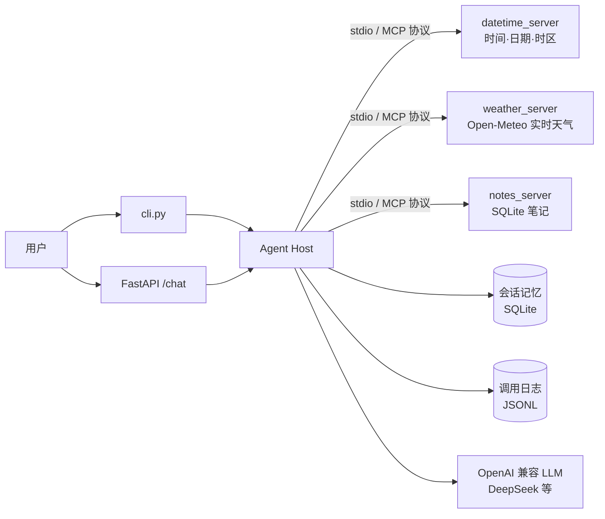

# MCP 多服务智能助手

把工具做成独立 MCP 服务、由 Agent 统一发现和调用的多服务智能助手。支持**多步工具串联**（如"查天气 → 记笔记"）、**会话记忆**（SQLite 持久化，重启不丢）、**调用日志**（JSONL 逐条记录），并提供 CLI、FastAPI 接口和 Docker 部署。

## 架构



- **工具与 Agent 解耦**：每个服务独立进程、独立启动，通过 MCP 协议暴露工具；新增服务只需在 `host/agent.py` 的 `SERVERS` 加一行。
- **多步串联**：Agent 主循环最多 8 轮工具调用，后面的工具可以使用前面工具的结果；工具报错不中断对话，反馈给模型修正或如实转告。
- **可观测**：每次工具调用的参数、结果摘要、耗时、状态都写入 `logs/tool_calls.jsonl`。

## 快速开始

```bash
pip install -r requirements.txt
cp .env.example .env   # 填入 LLM_API_KEY（任意 OpenAI 兼容接口，默认 DeepSeek）
python cli.py          # 命令行对话
python api.py          # 或启动 FastAPI，POST /chat
```

没有 API key 也能跑通全链路（mock 模式按规则路由工具，仅用于验证流程）：

```bash
MOCK_LLM=1 python cli.py
```

Docker：

```bash
docker compose up --build   # 笔记与记忆通过 volume 持久化
```

## 对话示例

```
你：深圳明天会下雨吗？如果会就帮我记一条带伞提醒
助手：[调用 get_weather_forecast → 发现降水概率 80% → 自动调用 create_note]
     深圳明天阵雨，降水概率 80%。已创建笔记 #7：出门带伞
```

## 评测

24 题评测集覆盖 5 类场景：单服务调用（日期/天气/笔记）、多服务串联、多轮记忆、异常输入（不存在的城市、非法日期）。

```bash
python eval/run_eval.py
```

指标：工具选择准确率、答案关键词命中率、平均响应时延、单次调用成本（按 token 用量和刊例价估算）。结果写入 `eval/results/`，详细分析见 [eval/REPORT.md](eval/REPORT.md)。

## 目录结构

```
servers/            # 三个独立 MCP Server（datetime / weather / notes）
host/agent.py       # MCP 客户端 + 工具注册 + 多步调用主循环
host/llm.py         # OpenAI 兼容客户端 + 离线 mock
host/memory.py      # 会话记忆（SQLite，滑动窗口）
host/logging_utils.py
cli.py / api.py     # 两种入口
eval/               # 评测集、评测脚本、评测报告
```

## 数据来源与边界

- 天气数据来自 [Open-Meteo](https://open-meteo.com/) 免费 API（无需 key），仅用于学习演示。
- 笔记与会话记忆存本地 SQLite，无云端同步。
- mock 模式只验证链路，评测结论以真实模型运行为准。
